<picture>
  <source media="(prefers-color-scheme: dark)" srcset="assets/header-dark.svg">
  
</picture>

  
  
  
  
  

## 👋 About me

I'm a computer science student in France (BUT Informatique) who would rather ship than talk about shipping.
I like the layer where software meets the real world: **drivers, disks, phones, networks and the house I live in.**

- 🛡️ **Honest by default.** Free, no ads, no account, no telemetry. If my app does something, it tells you.
- 🏠 **Local-first.** Most of what I build runs on your machine or on my own home server, not someone's cloud.
- 📐 **Docs → mockup → code → tests.** Every project has its own decision log before it has a line of code.
- 🌐 **Network & virtualization nerd.** Docker, reverse proxies, VPNs and VMs are my comfort zone.

## ⭐ Featured

<a href="https://github.com/1oma1e/Drivn">
  <picture>
    <source media="(prefers-color-scheme: dark)" srcset="assets/drivn-dark.svg">
    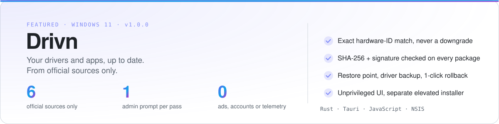
  </picture>
</a>

  <a href="https://github.com/1oma1e/Drivn/releases/latest"><b>⬇ Download Drivn</b></a> ·
  <a href="https://github.com/1oma1e/Drivn"><b>Read how it works</b></a>

## 🧰 Things I build

<a href="#-things-i-build"><picture><source media="(prefers-color-scheme: dark)" srcset="assets/safesweep-dark.svg">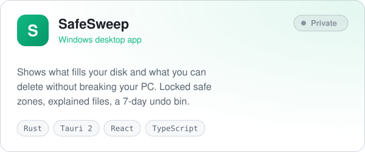</picture></a>
<a href="https://github.com/1oma1e/Hyphn"><picture><source media="(prefers-color-scheme: dark)" srcset="assets/hyphn-dark.svg">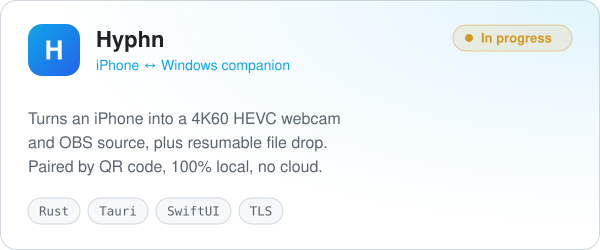</picture></a>
<a href="https://tchinz.1oma1e.club"><picture><source media="(prefers-color-scheme: dark)" srcset="assets/tchinz-dark.svg"></picture></a>
<a href="https://tchop.1oma1e.club"><picture><source media="(prefers-color-scheme: dark)" srcset="assets/tchop-dark.svg"></picture></a>
<a href="#-things-i-build"><picture><source media="(prefers-color-scheme: dark)" srcset="assets/apphome-dark.svg">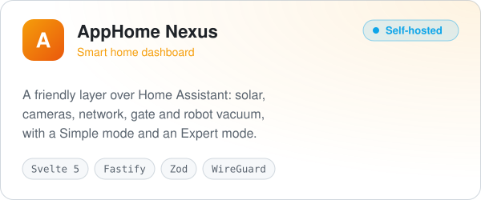</picture></a>
<a href="#-things-i-build"><picture><source media="(prefers-color-scheme: dark)" srcset="assets/powkey-dark.svg">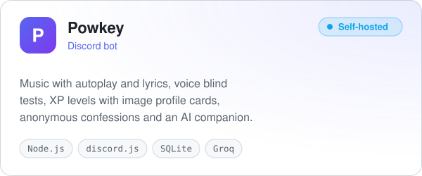</picture></a>
<a href="#-things-i-build"><picture><source media="(prefers-color-scheme: dark)" srcset="assets/stormisland-dark.svg">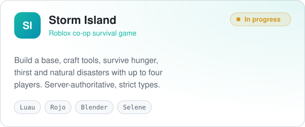</picture></a>
<a href="#-things-i-build"><picture><source media="(prefers-color-scheme: dark)" srcset="assets/spotifymigrate-dark.svg">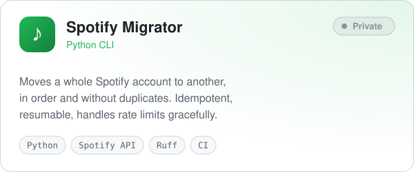</picture></a>

🎓 Also: <a href="https://github.com/Lecasly10/SAE_5"><b>Spot'It</b></a>, a team university project. Snap a car, a TensorFlow model recognizes it and adds it to your collection, Pokédex-style (Flutter · Node.js · MongoDB · Docker).

## 🏠 My homelab

Everything that is "live" above runs on a small Debian server at home, one `docker compose` per app, deployed with a single command that pushes, rebuilds and checks the site is up.

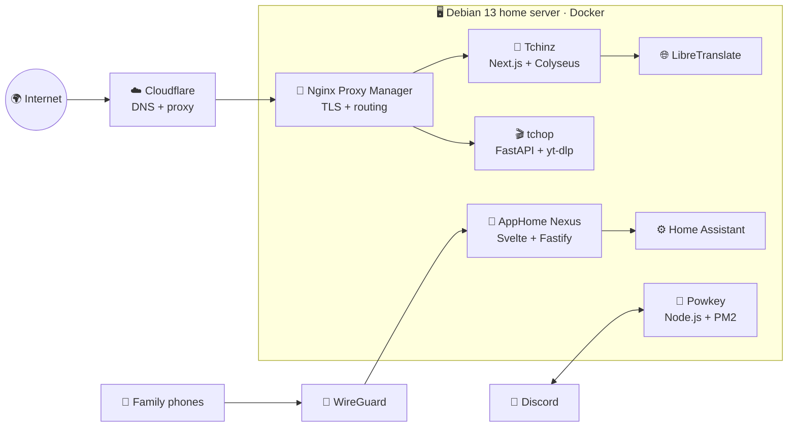

## 🛠️ Tech I use

<b>Languages</b>  
  <picture>
    <source media="(prefers-color-scheme: dark)" srcset="https://skillicons.dev/icons?i=rust,ts,python,swift,dart,lua,bash,powershell&theme=dark">
    
  </picture>

<b>Apps & frameworks</b>  
  <picture>
    <source media="(prefers-color-scheme: dark)" srcset="https://skillicons.dev/icons?i=tauri,react,nextjs,svelte,vite,tailwind,nodejs,fastapi,flutter,discordjs,tensorflow&theme=dark">
    
  </picture>

<b>Infra, data & tooling</b>  
  <picture>
    <source media="(prefers-color-scheme: dark)" srcset="https://skillicons.dev/icons?i=docker,nginx,cloudflare,debian,linux,githubactions,git,sqlite,mongodb,vitest&theme=dark">
    
  </picture>

<b>Design & notes</b>  
  <picture>
    <source media="(prefers-color-scheme: dark)" srcset="https://skillicons.dev/icons?i=figma,blender,obsidian&theme=dark">
    
  </picture>

## 📐 How I work

| Principle | In practice |
|---|---|
| 📓 **Docs first** | Each project is an Obsidian vault: vision, architecture, ADRs and a session log. Code that isn't documented isn't done. |
| 🎨 **Mockup before code** | Screens are designed and validated as clickable mockups before the first component is written. |
| 🔒 **Safe by design** | Server-authoritative game logic, unprivileged UIs with a separate elevated helper, signature and hash checks, strict input validation. |
| ✅ **Ship & verify** | Lint, types and tests gate every commit. One command deploys, then checks the live site actually answers. |

## 🔭 Right now

- 📱 Shipping **[Hyphn](https://github.com/1oma1e/Hyphn)**: an iPhone as a 4K60 Windows webcam over Wi-Fi or USB, with auto updates and an English/French UI.
- 🏝️ Rebuilding the interface of **Storm Island** and modelling its world in Blender.
- 🎲 Adding new party games to **Tchinz**. [Come play](https://tchinz.1oma1e.club) with your friends.

 

  
  

Made in France 🇫🇷 · Built with care, shipped with docs.

